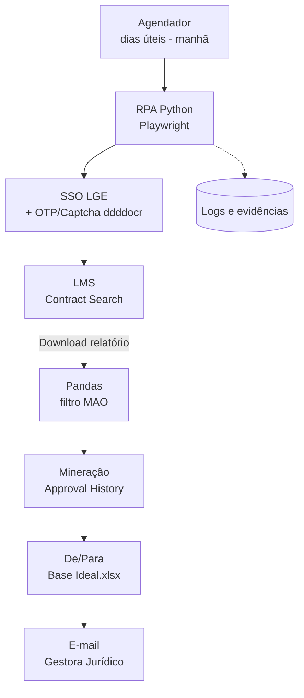

# 2 - KickOff / OnePage

**Projeto:** Automação do Processo de Contratos Jurídicos — RPA Ideal Raw (LMS)
**Patrocinador:** Gestora do Jurídico – Contratos, LG Electronics Manaus *[nome a preencher]*

| Versão | Data | Autor | Comentários |
| :---: | :---: | :--- | :--- |
| 0.1 | 30/09/2026 | Sannyer Carvalho | Versão inicial |

---

## 1. OnePage

### Visão em uma frase

> **Um robô que, todo dia útil pela manhã, entrega ao Jurídico de Manaus a Base Ideal atualizada com as datas de cada etapa dos contratos, substituindo 4–5 horas de coleta manual por uma execução autônoma de menos de 40 minutos.**

### Escopo

- Login automático no SSO da LG com geração do OTP temporário (incluindo a leitura do Captcha).
- Aplicação dos filtros no LMS (Subsidiary `LGESP` e período de referência) e exportação do relatório macro.
- Filtragem dos contratos de Manaus (`MAO`) com Pandas.
- Consulta individual de cada contrato e extração das datas do "Approval History".
- Aplicação do De/Para e geração da **Base Ideal.xlsx** no layout atual (aba *Ideal Raw*).
- Envio da base por e-mail, com resumo da execução.
- Logs de execução, tentativas automáticas (retry) e isolamento de falhas por contrato.
- Agendamento em dias úteis, no período da manhã.

### Não Escopo

- Alterar, aprovar ou criar contratos no LMS. O robô **apenas lê** dados.
- Contratos de outras filiais além de Manaus.
- Dashboards ou análises de BI sobre a Base Ideal (evolução futura).
- Integração via API com o LMS (não disponível).
- Substituir a análise humana dos contratos.

### Personas

| Persona | Necessidade | Como o projeto atende |
| :--- | :--- | :--- |
| **Gestora do Jurídico** | Acompanhar prazos e gargalos dos contratos com dados confiáveis | Recebe a base pronta por e-mail todo dia útil |
| **Analista de Contratos** | Deixar de gastar horas copiando datas do LMS | Passa a atuar apenas na validação de exceções |
| **TI / Sustentação** | Operar o robô com segurança e rastreabilidade | Imagem Docker versionada, logs e credenciais no `.env` |

### Arquitetura macro

**Stack:** Python 3.11 · Playwright · ddddocr (OCR) · Pandas · Docker · GitHub Actions (CI/CD) · GHCR.

### Marcos

| Marco | Entrega | Conteúdo |
| :---: | :--- | :--- |
| **M1** | 1ª Macroentrega | PUR v1.0 aprovado, mapeamento de seletores, protótipo de login no LMS, planejamento do MVP |
| **M2** | MVP | Robô ponta a ponta (login → exportação → filtro MAO → mineração → Base Ideal → e-mail), com termo de aceite intermediário |
| **M3** | Encerramento | Agendamento em produção, robustez (retry, logs), manuais, Termo de Aceite Definitivo e cálculo de ROI |

> As datas dos marcos devem ser definidas com o orientador e registradas no cronograma da pasta `6 - Status Report`.

---

## 2. Quadro É / Não é / Faz / Não faz

| **É** | **Não é** |
| :--- | :--- |
| Um robô RPA de extração e consolidação de dados | Um sistema substituto do LMS |
| Uma ferramenta de apoio ao Jurídico de Manaus | Uma ferramenta de decisão jurídica |
| Uma solução agendada e autônoma | Um serviço em tempo real |
| Somente leitura sobre o LMS | Uma integração oficial ou API do LMS |

| **Faz** | **Não faz** |
| :--- | :--- |
| Autentica no SSO com OTP temporário | Altera, aprova ou reprova contratos |
| Exporta e filtra contratos `LGESP` / `MAO` | Trata contratos de outras filiais |
| Extrai as datas do Approval History | Interpreta o conteúdo jurídico dos contratos |
| Gera a Base Ideal.xlsx e envia por e-mail | Gera dashboards (fora do escopo atual) |
| Registra logs e isola falhas por contrato | Burla controles de acesso fora das credenciais autorizadas |

---

## 3. Proposta de Valor

- **Tempo:** de 8–10 h/semana de trabalho manual para uma execução diária autônoma de menos de 40 minutos.
- **Frequência:** de cerca de 2 atualizações por semana para 5 (todo dia útil).
- **Qualidade:** fim dos erros de digitação e regras padronizadas (De/Para, última data válida, etapas não atingidas ficam nulas).
- **Rastreabilidade:** log de cada execução e evidência das falhas.
- **Foco:** a equipe do Jurídico passa da coleta para a análise (Human-in-the-Loop).

---

## 4. MVP Canvas

| Bloco | Conteúdo |
| :--- | :--- |
| **Proposta do MVP** | Gerar a Base Ideal.xlsx de Manaus automaticamente, a partir do LMS, com as datas do Approval History |
| **Personas segmentadas** | Gestora do Jurídico e Analista de Contratos (filial Manaus) |
| **Jornadas** | Robô executa → e-mail com a base chega → gestora valida as exceções → base é usada na análise |
| **Funcionalidades** | Login SSO+OTP; filtros e download; filtro MAO; mineração do Approval History; De/Para; exportação xlsx; e-mail |
| **Resultado esperado** | Base gerada sem intervenção manual e com dados iguais aos da base manual para a mesma amostra |
| **Métricas para validar** | Tempo de execução < 40 min; 100% de concordância em uma amostra de validação; 0 contratos perdidos por falha isolada |
| **Custo e cronograma** | Horas do time acadêmico + ambiente com Docker; ver marcos M1–M3 |

---

## 5. Apresentação de KickOff — Roteiro

1. Contexto e dor do Jurídico (AS-IS, 4–5 h por execução)
2. Enunciado do desafio e causa-raiz
3. Visão, escopo e não escopo
4. Arquitetura macro e stack
5. Marcos M1, M2 e M3
6. Riscos principais e dependências (acesso ao LMS, credenciais institucionais, autorização da TI)
7. Próximos passos e acordos

---

## 6. Ata de Abertura (KickOff)

| Campo | Registro |
| :--- | :--- |
| **Data / hora** | *[A PREENCHER]* |
| **Local / meio** | *[A PREENCHER]* |
| **Participantes** | *[A PREENCHER — equipe, patrocinadora, orientador]* |
| **Pauta** | Apresentação do OnePage, validação de escopo e marcos, definição de acessos |

**Decisões tomadas:**

1. *[A PREENCHER]*

**Pendências / ações:**

| Ação | Responsável | Prazo |
| :--- | :--- | :---: |
| Confirmar credencial institucional (`legal.manaus`) para uso do robô | *[A PREENCHER]* | |
| Definir destinatários do e-mail da Base Ideal | *[A PREENCHER]* | |
| Definir período de referência do filtro "Request Date" | *[A PREENCHER]* | |

**Aprovação do patrocinador:** ______________________  Data: ___/___/______
