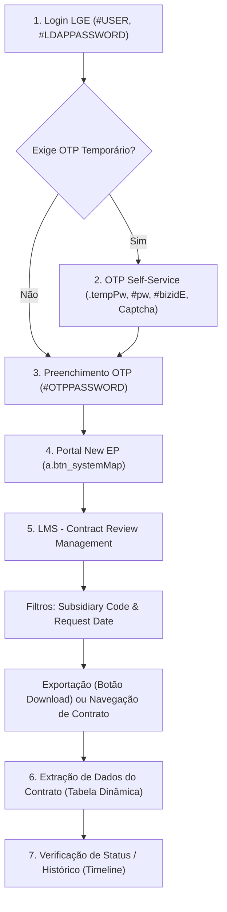

# 📋 Documentação e Mapeamento de Seletores - Automação LMS / LGE

Este documento contém o mapeamento estruturado de seletores CSS, tipos de elementos, exemplos de código padronizados em **Playwright (Python)** e observações de comportamento dinâmico para a automação do sistema LMS da LG Electronics.

---

## 🗺️ Fluxo Geral da Automação



---

## 1. Login Corporativo (Login LGE)

> [!NOTE]
> O campo de OTP é dinâmico: ele só é exibido na página após o preenchimento do **User ID** e a perda de foco (evento de *blur* / tecla `Tab`).

| Campo / Elemento | Tipo | Seletor CSS / Locator | Exemplo de Uso (Playwright) | Observações |
| :--- | :---: | :--- | :--- | :--- |
| **User ID** | Input | `#USER` | `page.fill("#USER", "seu_usuario")` | Usuário corporativo. Dispara exibição do OTP após perder o foco. |
| **Password** | Input | `#LDAPPASSWORD` | `page.fill("#LDAPPASSWORD", "sua_senha")` | Senha de rede LDAP. |
| **OTP Password** | Input | `#OTPPASSWORD` | *Ver código abaixo* | Renderizado condicionalmente após o `Tab` no `#USER`. |
| **OTP Self-Service** | Botão / Link | `#OTP` | `page.click("#OTP")` | Link para tela/popup de requisição de OTP temporário. |

### Exemplo de Fluxo de Login:
```python
# 1. Preenche o usuário
page.fill("#USER", "seu_usuario")

# 2. Pressiona Tab para acionar o trigger do OTP
page.locator("#USER").press("Tab")

# 3. Aguarda o campo de OTP ficar visível
page.wait_for_selector("#OTPPASSWORD", state="visible", timeout=5000)

# 4. Preenche a senha de rede e o código OTP
page.fill("#LDAPPASSWORD", "sua_senha")
page.fill("#OTPPASSWORD", "123456")
```

---

## 2. Autoatendimento de OTP Temporário (OTP Self-Service)

> [!TIP]
> Em vez de abrir o popup a partir da tela principal, é mais rápido e confiável navegar diretamente para a URL base do serviço de senha temporária.

| Campo / Elemento | Tipo | Seletor CSS / Locator | Exemplo de Uso (Playwright) | Observações |
| :--- | :---: | :--- | :--- | :--- |
| **OTP Temporary** | Botão / Link | `.tempPw` | *Ver código de popup abaixo* | Abre janela popup de requisição de OTP temporário. |
| **Password** | Input | `#pw` | `page.fill("#pw", "SUA_SENHA")` | Senha de autorização de autoatendimento. |
| **Botão Login** | Botão | `#myButton` | `page.click("#myButton")` | Confirma as credenciais iniciais. |
| **Employee Number** | Input | `#bizidE` | `page.fill("#bizidE", "SEU_NUMERO_EMPLOYEE")` | Matrícula do colaborador. |
| **Personal ID Code** | Input | `#pcodeE` | `page.fill("#pcodeE", "19900101")` | Data de identificação pessoal / código. |
| **Pictorial Symbol** | Input | `#answerE` | `page.fill("#answerE", "TEXTO_DO_CAPTCHA")` | Resposta do Captcha visual. |
| **Botão OK** | Botão | `input[value="Ok"]` | `page.click('input[value="Ok"]:visible')` | Submete a solicitação do OTP. |
| **Recarregar Captcha** | Imagem | `img[src*="captcha_reload"]` | `page.click('img[src*="captcha_reload"]:visible')` | Gera uma nova imagem caso a anterior esteja ilegível. |

### Exemplo de Manipulação de Popup vs. Navegação Direta:
```python
# Opção A: Capturar popup ao clicar
with page.expect_popup() as popup_info:
    page.click(".tempPw")
popup = popup_info.value
popup.wait_for_load_state("domcontentloaded")

# Opção B (Recomendada): Navegação direta pela URL
base_url = "https://login.lge.com"  # Ajustar domínio
page.goto(f"{base_url}/selfservice/TempPasswordRequestPcode.jsp?lang=eng")
```

---

## 3. Portal Corporativo (New EP)

| Campo / Elemento | Tipo | Seletor CSS / Locator | Exemplo de Uso (Playwright) | Observações |
| :--- | :---: | :--- | :--- | :--- |
| **System Map** | Menu / Link | `a.btn_systemMap` | `page.locator("a.btn_systemMap").click()` | Abre o mapa geral de sistemas do Portal New EP (`http://newep.lge.com/portal/main/portalMain.do`). |

---

## 4. LMS - Busca e Gestão de Contratos

URL da Aplicação: `https://lms.lge.com/#/app/contract/search`

> [!IMPORTANT]
> Os filtros de pesquisa utilizam o componente **React Select**. Nesses campos, um simples `page.fill()` direto no contêiner pode falhar. É necessário focar o input interno `.select__input` e depois clicar na opção correspondente em `.select__option`.

| Campo / Elemento | Tipo | Seletor CSS / Locator | Exemplo de Uso (Playwright) | Observações |
| :--- | :---: | :--- | :--- | :--- |
| **Contract Review Search** | Navegação | `https://lms.lge.com/#/app/contract/search` | `page.goto("https://lms.lge.com/#/app/contract/search")` | URL da tela principal de pesquisa de contratos. |
| **Subsidiary Code** | Dropdown | `.react-select` (Label: Subsidiary Code) | *Ver helper React Select abaixo* | Dropdown pesquisável. Digita o código e clica na opção. |
| **Request Date** | Dropdown | `.react-select` (Label: Request Date) | *Ver helper React Select abaixo* | Seleciona o período (ex: *"Last 10 years"*). |
| **Botão Download** | Botão | `button:has-text("Download")` | *Ver exemplo de download abaixo* | Exporta relatório com a relação de contratos filtrados. |

### Helper para Seleção em React Select:
```python
def selecionar_react_select(page, label_texto: str, valor_opcao: str):
    # 1. Encontra o contêiner do react-select associado ao label
    container = page.locator(".react-select").filter(has_text=label_texto)
    
    # 2. Localiza o input de busca interno e abre as opções
    input_field = container.locator("input.select__input")
    input_field.click()
    input_field.fill(valor_opcao)
    
    # 3. Aguarda e clica na opção do menu
    opcao = page.locator(".select__option").filter(has_text=valor_opcao).first
    opcao.wait_for(state="visible", timeout=5000)
    opcao.click()

# Exemplo de download de arquivo:
with page.expect_download() as download_info:
    page.click('button:has-text("Download")')
download = download_info.value
download.save_as("relatorio_contratos.xlsx")
```

---

## 5. Página de Detalhes do Contrato (Metadados)

> [!TIP]
> Os campos da página de detalhes estão dispostos em pares de células de tabela `<td>`. O seletor utiliza o combinador adjacente `+ td` para capturar a célula de valor que vem imediatamente após a célula do rótulo `span:text-is("...")`.

| Campo / Elemento | Tipo | Seletor CSS / Locator | Exemplo de Leitura |
| :--- | :---: | :--- | :--- |
| **Management Number** | Célula Tabela | `td:has(span:text-is("Management Number")) + td` | `page.locator('td:has(span:text-is("Management Number")) + td').inner_text().strip()` |
| **Counterparty** | Célula Tabela | `td:has(span:text-is("Counterparty")) + td` | `page.locator('td:has(span:text-is("Counterparty")) + td').inner_text().strip()` |
| **Contract Name** | Célula Tabela | `td:has(span:text-is("Contract Name")) + td` | `page.locator('td:has(span:text-is("Contract Name")) + td').inner_text().strip()` |
| **Contract Type** | Célula Tabela | `td:has(span:text-is("Contract type")) + td` | `page.locator('td:has(span:text-is("Contract type")) + td').inner_text().strip()` |
| **Requester** | Célula Tabela | `td:has(span:text-is("Requester")) + td` | `page.locator('td:has(span:text-is("Requester")) + td').inner_text().strip()` |
| **Contract Period** | Célula Tabela | `td:has(span:text-is("Contract Period")) + td` | `page.locator('td:has(span:text-is("Contract Period")) + td').inner_text().strip()` |
| **Contract Amount** | Célula Tabela | `td:has(span:text-is("Contract amount")) + td` | `page.locator('td:has(span:text-is("Contract amount")) + td').inner_text().strip()` |
| **Person in Charge (Legal)** | Célula Tabela | `td:has(span:text-is("A person in charge of legal (team)")) + td` | `page.locator('td:has(span:text-is("A person in charge of legal (team)")) + td').inner_text().strip()` |

### Função Pronta para Extrair Todos os Metadados:
```python
def extrair_metadados_contrato(page) -> dict:
    campos = [
        "Management Number",
        "Counterparty",
        "Contract Name",
        "Contract type",
        "Requester",
        "Contract Period",
        "Contract amount",
        "A person in charge of legal (team)"
    ]
    dados = {}
    for campo in campos:
        locator = page.locator(f'td:has(span:text-is("{campo}")) + td')
        if locator.count() > 0:
            dados[campo] = locator.first.inner_text().strip()
        else:
            dados[campo] = None
    return dados
```

---

## 6. Histórico de Status e Timeline do Contrato

Status e logs de auditoria registrados na timeline / comentários do contrato:

| Evento / Status | Tipo | Seletor CSS / Locator | Verificação no Playwright |
| :--- | :---: | :--- | :--- |
| **Review Request Msg** | Tag / Mensagem | `span:has-text("I request a review of the contract.")` | `page.locator('span:has-text("I request a review of the contract.")').is_visible()` |
| **Review Completed** | Comentário | `.Comment_Content:has-text("Completion of contract review")` | `page.locator('.Comment_Content:has-text("Completion of contract review")').is_visible()` |
| **Legal Team Consent** | Comentário | `.Comment_Content:has-text("Legal Team Consent")` | `page.locator('.Comment_Content:has-text("Legal Team Consent")').is_visible()` |
| **Approval Completed** | Comentário | `.Comment_Content:has-text("Status changed to in Approval Completed")` | `page.locator('.Comment_Content:has-text("Status changed to in Approval Completed")').is_visible()` |
| **Processing Approval** | Comentário | `.Comment_Content:has-text("Status changed to in Processing Approval")` | `page.locator('.Comment_Content:has-text("Status changed to in Processing Approval")').is_visible()` |
| **Contract Expired** | Comentário | `.Comment_Content:has-text("Contract Expired")` | `page.locator('.Comment_Content:has-text("Contract Expired")').is_visible()` |

---

## 📁 Arquivos Gerados no Projeto

Os seguintes arquivos foram gerados e estão prontos para entrega:

1. 📄 **`Mapeamento_Seletores_Formatado.xlsx`**: Planilha Excel profissional com cabeçalho corporativo, cores, larguras ajustadas, quebra de texto (*wrap text*), linhas zebradas e filtros.
2. 📊 **`Mapeamento_Seletores_Formatado.csv`**: Arquivo CSV padronizado em UTF-8 com BOM (compatível diretamente com Excel em português sem caracteres corrompidos).
3. 📖 **`Mapeamento_Seletores_LMS.md`**: Guia técnico completo em Markdown para a equipe de desenvolvimento e documentação técnica do projeto.
